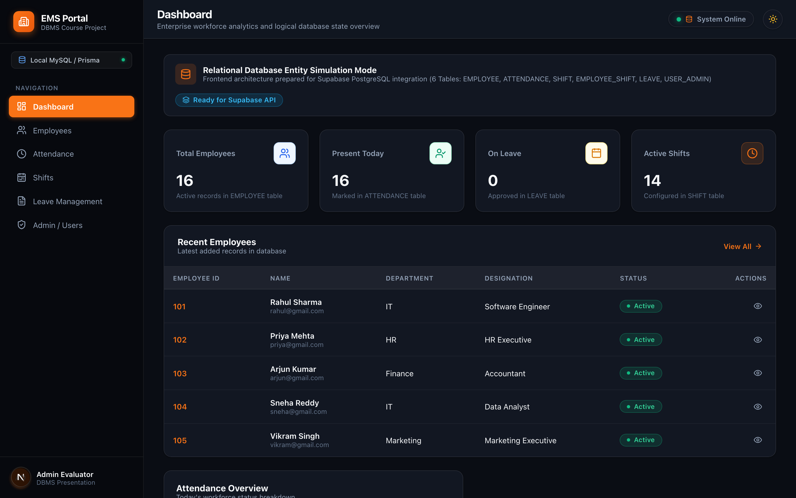
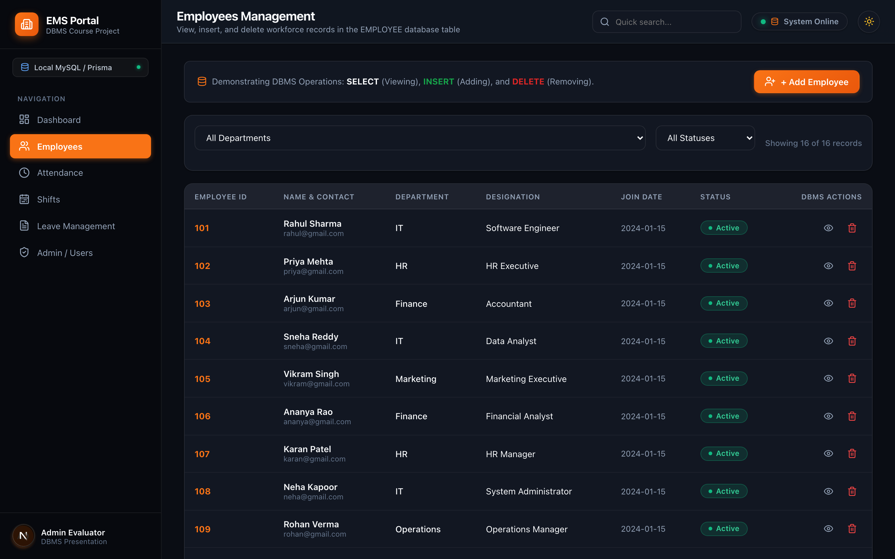
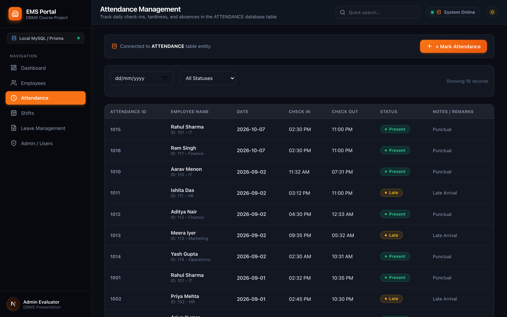
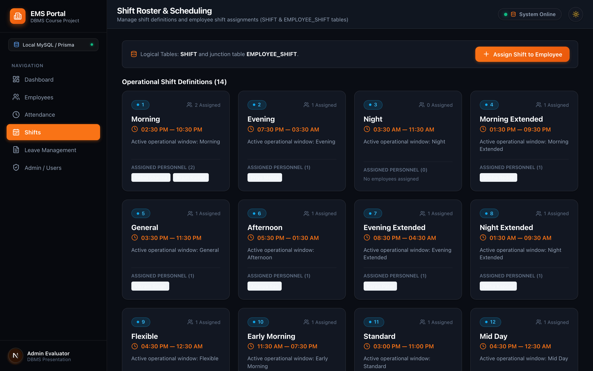
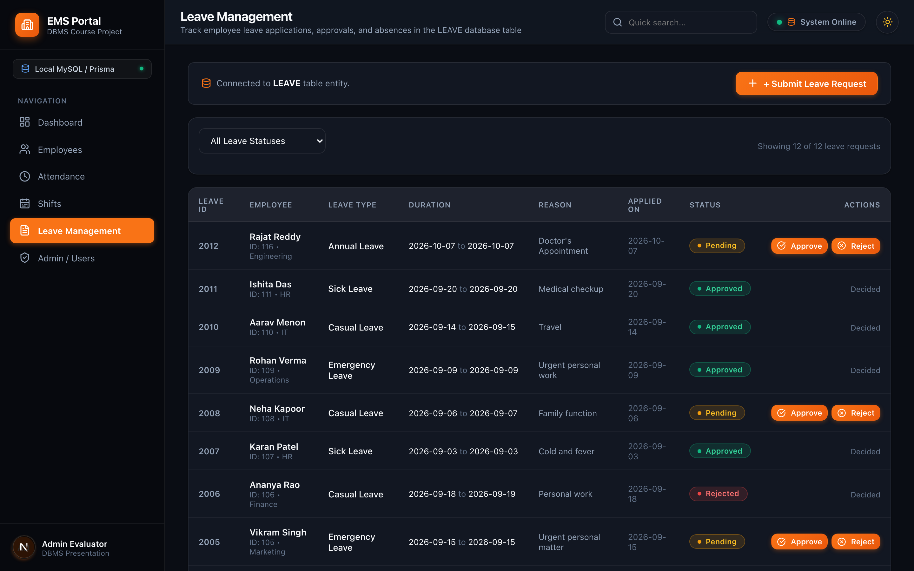
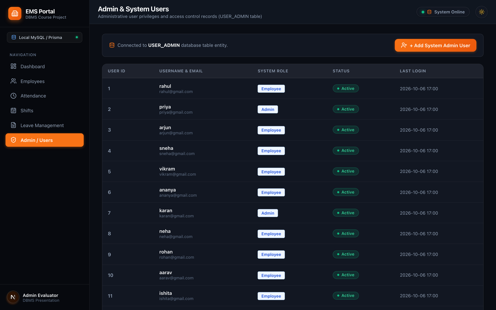
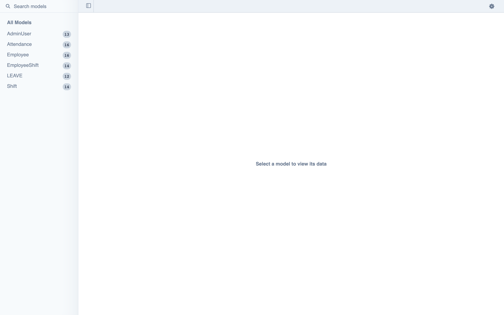

# EMPLOYEE ATTENDANCE, SHIFT, LEAVE MANAGEMENT SYSTEM
## DBMS Course Project Report

- **Student Name:** Maydhaansh Nanda
- **Roll Number:** 25WU0102155
- **Course:** Database Management Systems (DBMS)
- **Faculty Name:** Dr. Kiran Mayee Adavala
- **University:** Woxsen University
- **Branch:** CSE - AIML
- **Academic Year:** 2025–2029

---

## 2. Abstract

The Employee Attendance, Shift, and Leave Management System is a database-driven enterprise web application developed to manage workforce demographics, shift scheduling, daily attendance punch logs, and multi-tier leave administration in a structured, normalized relational system. The application uses MySQL 8.0 (InnoDB engine) as the underlying database layer, Node.js with Next.js 16 (Pages Router) for serverless RESTful backend services, React 19 with modern Vanilla CSS for the user interface, and Prisma ORM 6.19 for type-safe database connectivity and schema migrations. The system supports full employee master maintenance, dynamic shift scheduling, attendance recording with automated punctuality classification, leave application lifecycles (Pending, Approved, Rejected), role-based administrative access control (RBAC), and executive analytical reporting dashboards. Automated database constraints, composite primary and unique keys (preventing duplicate daily attendance entries), foreign key cascades, and ACID-compliant transactional writes protect data integrity and ensure consistent state across all workforce management operations.

3. Introduction and Problem Statement


### 3.1 Introduction

In modern commercial enterprises and institutional settings, workforce operations generate continuous streams of relational data: personnel are assigned to corporate departments, operational shifts rotate across morning, day, evening, and night slots, employees record daily punch-in and punch-out timestamps, and formal leave requests require managerial review and status updates. Managing these records independently or through disparate spreadsheets leads to data redundancy, synchronization lag, and inconsistent operational reports. This project models the complete enterprise human resource workflow using a rigorously normalized relational database integrated with a responsive full-stack web application.


### 3.2 Problem Statement

Organizations require an integrated, dependable system to maintain employee information, schedule multi-shift rotations, record real-time attendance, process categorized leave applications, and deliver executive audit reports. The system must preserve referential integrity between all operational entities and prevent invalid operations such as scheduling non-existent staff, creating duplicate attendance punch records on the same calendar date, approving overlapping leave requests without managerial authorization, or generating orphaned transactional logs when employees or shifts are modified.

4. Objectives and Scope


### 4.1 Objectives

Maintain employee profiles, operational shifts, employee-shift assignments, attendance logs, leave requests, and administrative user credentials in MySQL 8.0.

Provide comprehensive CRUD operations for Employee, Shift, and Leave entities through a responsive web interface.

Enforce strict referential integrity via foreign key constraints (ON DELETE CASCADE / RESTRICT) preventing orphaned records.

Implement composite unique constraints (UNIQUE(Employee_ID, Date)) to prevent duplicate daily check-in logs.

Model the many-to-many relationship between employees and shifts using an associative junction table (EMPLOYEE_SHIFT).

Streamline formal leave lifecycles through interactive admin decisioning modals (Pending → Approved / Rejected).

Implement Role-Based Access Control (RBAC) mapping system credentials to user accounts (Super Admin, HR Manager, System Auditor).

Deliver real-time operational analytics and KPI dashboards summarizing headcount, punctuality rates, and department rosters.


### 4.2 Scope

Employee master catalog with departmental filtering, search, and profile inspection.

Daily attendance tracking with punch-in/out timestamps and automatic status classification (Present, Late, Absent, On Leave).

Shift schedule configuration and assignment roster across Morning, Standard Day, Evening, and Night shifts.

Leave request submission, tracking, and instantaneous administrative approval workflows.

Administrative security and credentials management.

Analytical querying for department headcount, shift coverage, leave distribution, and workforce punctuality rates.

Full-stack web application deployment using Next.js 16, React 19, Prisma ORM 6, and MySQL 8.0.

5. Software and Hardware Requirements


| Category | Requirement |
| --- | --- |
| Operating System | Windows 10/11 / macOS 14+ / Linux (Ubuntu 22.04 LTS) |
| Backend Framework | Next.js 16.3 (Node.js v20+ Serverless API Routes) |
| Relational Database | MySQL 8.0 (InnoDB Storage Engine) |
| ORM & Connectivity | Prisma ORM 6.19 (@prisma/client) |
| Frontend UI | React 19.2, Vanilla CSS Design System |
| UI Components & Icons | Lucide React (Vector Graphic Icons) |
| Database Visualizer | Prisma Studio (Port 5555 GUI) |
| Build Process | Next.js Compiler / Turbopack (npm run dev / npm run build) |
| API Testing | cURL, REST Client, and Prisma Automated Assertions |
| Web Browser | Modern Chromium / Firefox / Safari |
| Recommended Hardware | Multi-core processor (Apple Silicon / Intel Core i5/i7), 8 GB RAM, 10 GB free storage |


6. ER Diagram

The Entity-Relationship (ER) diagram models the conceptual architecture of the Employee Attendance, Shift, and Leave Management System. It comprises six core entities: EMPLOYEE, SHIFT, EMPLOYEE_SHIFT, ATTENDANCE, LEAVE, and USER_ADMIN. The diagram highlights primary keys (PK), foreign keys (FK), unique constraints, attributes, and cardinality ratios that mirror real-world organizational governance.

EMPLOYEE to ATTENDANCE (1 : N): One employee logs multiple daily attendance entries over their employment tenure.

EMPLOYEE to LEAVE (1 : N): An employee can submit zero, one, or multiple leave applications.

EMPLOYEE to SHIFT via EMPLOYEE_SHIFT (M : N): An employee can rotate through different shifts over time, and a shift accommodates multiple employees simultaneously.

EMPLOYEE to USER_ADMIN (1 : 0..1): An employee may possess at most one administrative login credential.

Figure. Entity-Relationship (ER) Diagram for Employee Attendance, Shift, and Leave Management System

7. Relational Schema and Normalization


### 7.1 Relational Schema

The conceptual ER model is mapped into six relational tables:

EMPLOYEE (Employee_ID [PK], Name, Email [UK], Phone, Department, Designation)

SHIFT (Shift_ID [PK], Shift_Name, Start_Time, End_Time)

EMPLOYEE_SHIFT (Employee_ID [PK, FK], Shift_ID [PK, FK], Assigned_Date [PK])

ATTENDANCE (Attendance_ID [PK], Employee_ID [FK], Date, Check_In, Check_Out, Status) — UNIQUE(Employee_ID, Date)

LEAVE (Leave_ID [PK], Employee_ID [FK], Leave_Type, Start_Date, End_Date, Reason, Status)

USER_ADMIN (User_ID [PK], Employee_ID [FK, UK], Username [UK], Role)


### 7.2 Normalization Analysis

The relational schema adheres to standard database normalization principles from 1NF through BCNF to eliminate data anomalies, minimize redundancy, and ensure high update performance:

First Normal Form (1NF): Each column stores atomic, indivisible values. Repeating groups and multivalued attributes (such as multiple shifts or historical attendance punches) are decoupled into distinct relational tables.

Second Normal Form (2NF): The schema satisfies 1NF, and all non-key attributes are fully functionally dependent on the entire primary key. In the associative entity EMPLOYEE_SHIFT with composite key (Employee_ID, Shift_ID, Assigned_Date), there are no partial dependencies.

Third Normal Form (3NF): The schema satisfies 2NF and exhibits zero transitive dependencies (X → Y → Z). Non-key attributes (Department, Designation, Phone) depend exclusively on the primary key Employee_ID and not on other non-key attributes.

Boyce-Codd Normal Form (BCNF): For every non-trivial functional dependency X → Y, X is a superkey. Candidate keys such as Email in EMPLOYEE and Username in USER_ADMIN are strictly unique, guaranteeing BCNF conformance.

8. Data Dictionary (Table Structure, Data Types, Constraints)

The tables below reproduce the actual MySQL DESC structure of the implemented database, including Field, Type, Null, Key, Default, and Extra values.


### 8.1 EMPLOYEE


| Field | Type | Null | Key | Default | Extra |
| --- | --- | --- | --- | --- | --- |
| Employee_ID | int | NO | PRI | NULL |  |
| Name | varchar(100) | NO |  | NULL |  |
| Email | varchar(100) | YES | UNI | NULL |  |
| Phone | varchar(15) | YES |  | NULL |  |
| Department | varchar(100) | YES |  | NULL |  |
| Designation | varchar(100) | YES |  | NULL |  |


### 8.2 SHIFT


| Field | Type | Null | Key | Default | Extra |
| --- | --- | --- | --- | --- | --- |
| Shift_ID | int | NO | PRI | NULL |  |
| Shift_Name | varchar(50) | NO |  | NULL |  |
| Start_Time | time | NO |  | NULL |  |
| End_Time | time | NO |  | NULL |  |


### 8.3 EMPLOYEE_SHIFT


| Field | Type | Null | Key | Default | Extra |
| --- | --- | --- | --- | --- | --- |
| Employee_ID | int | NO | PRI | NULL |  |
| Shift_ID | int | NO | PRI | NULL |  |
| Assigned_Date | date | NO | PRI | NULL |  |


### 8.4 ATTENDANCE


| Field | Type | Null | Key | Default | Extra |
| --- | --- | --- | --- | --- | --- |
| Attendance_ID | int | NO | PRI | NULL |  |
| Employee_ID | int | NO | MUL | NULL |  |
| Date | date | NO |  | NULL |  |
| Check_In | time | YES |  | NULL |  |
| Check_Out | time | YES |  | NULL |  |
| Status | varchar(20) | YES |  | NULL |  |


### 8.5 LEAVE


| Field | Type | Null | Key | Default | Extra |
| --- | --- | --- | --- | --- | --- |
| Leave_ID | int | NO | PRI | NULL |  |
| Employee_ID | int | NO | MUL | NULL |  |
| Leave_Type | varchar(50) | YES |  | NULL |  |
| Start_Date | date | YES |  | NULL |  |
| End_Date | date | YES |  | NULL |  |
| Reason | varchar(255) | YES |  | NULL |  |
| Status | varchar(20) | YES |  | NULL |  |


### 8.6 USER_ADMIN


| Field | Type | Null | Key | Default | Extra |
| --- | --- | --- | --- | --- | --- |
| User_ID | int | NO | PRI | NULL |  |
| Employee_ID | int | YES | UNI | NULL |  |
| Username | varchar(50) | NO | UNI | NULL |  |
| Role | varchar(20) | NO |  | NULL |  |


Note: The tables above reproduce the actual MySQL DESC structure of the implemented database, including Field, Type, Null, Key, Default, and Extra values.
## 9. SQL Commands Used (DDL, DML) with Sample Outputs

### 9.1 Database and Table Creation (DDL)

```sql
CREATE DATABASE IF NOT EXISTS EmployeeManagementDB;
USE EmployeeManagementDB;

CREATE TABLE `EMPLOYEE` (
  `Employee_ID` INT NOT NULL,
  `Name` VARCHAR(100) NOT NULL,
  `Email` VARCHAR(100) DEFAULT NULL,
  `Phone` VARCHAR(15) DEFAULT NULL,
  `Department` VARCHAR(100) DEFAULT NULL,
  `Designation` VARCHAR(100) DEFAULT NULL,
  PRIMARY KEY (`Employee_ID`),
  UNIQUE KEY `Email` (`Email`)
) ENGINE=InnoDB DEFAULT CHARSET=utf8mb4;

CREATE TABLE `SHIFT` (
  `Shift_ID` INT NOT NULL,
  `Shift_Name` VARCHAR(50) NOT NULL,
  `Start_Time` TIME NOT NULL,
  `End_Time` TIME NOT NULL,
  PRIMARY KEY (`Shift_ID`)
) ENGINE=InnoDB DEFAULT CHARSET=utf8mb4;

CREATE TABLE `EMPLOYEE_SHIFT` (
  `Employee_ID` INT NOT NULL,
  `Shift_ID` INT NOT NULL,
  `Assigned_Date` DATE NOT NULL,
  PRIMARY KEY (`Employee_ID`, `Shift_ID`, `Assigned_Date`),
  KEY `Shift_ID` (`Shift_ID`),
  CONSTRAINT `employee_shift_ibfk_1` FOREIGN KEY (`Employee_ID`) 
    REFERENCES `EMPLOYEE` (`Employee_ID`),
  CONSTRAINT `employee_shift_ibfk_2` FOREIGN KEY (`Shift_ID`) 
    REFERENCES `SHIFT` (`Shift_ID`)
) ENGINE=InnoDB DEFAULT CHARSET=utf8mb4;

CREATE TABLE `ATTENDANCE` (
  `Attendance_ID` INT NOT NULL,
  `Employee_ID` INT NOT NULL,
  `Date` DATE NOT NULL,
  `Check_In` TIME DEFAULT NULL,
  `Check_Out` TIME DEFAULT NULL,
  `Status` VARCHAR(20) DEFAULT NULL,
  PRIMARY KEY (`Attendance_ID`),
  UNIQUE KEY `Employee_ID` (`Employee_ID`, `Date`),
  CONSTRAINT `attendance_ibfk_1` FOREIGN KEY (`Employee_ID`) 
    REFERENCES `EMPLOYEE` (`Employee_ID`)
) ENGINE=InnoDB DEFAULT CHARSET=utf8mb4;

CREATE TABLE `LEAVE` (
  `Leave_ID` INT NOT NULL,
  `Employee_ID` INT NOT NULL,
  `Leave_Type` VARCHAR(50) DEFAULT NULL,
  `Start_Date` DATE DEFAULT NULL,
  `End_Date` DATE DEFAULT NULL,
  `Reason` VARCHAR(255) DEFAULT NULL,
  `Status` VARCHAR(20) DEFAULT NULL,
  PRIMARY KEY (`Leave_ID`),
  KEY `Employee_ID` (`Employee_ID`),
  CONSTRAINT `leave_ibfk_1` FOREIGN KEY (`Employee_ID`) 
    REFERENCES `EMPLOYEE` (`Employee_ID`)
) ENGINE=InnoDB DEFAULT CHARSET=utf8mb4;

CREATE TABLE `USER_ADMIN` (
  `User_ID` INT NOT NULL,
  `Employee_ID` INT DEFAULT NULL,
  `Username` VARCHAR(50) NOT NULL,
  `Role` VARCHAR(20) NOT NULL,
  PRIMARY KEY (`User_ID`),
  UNIQUE KEY `Username` (`Username`),
  UNIQUE KEY `Employee_ID` (`Employee_ID`),
  CONSTRAINT `user_admin_ibfk_1` FOREIGN KEY (`Employee_ID`) 
    REFERENCES `EMPLOYEE` (`Employee_ID`)
) ENGINE=InnoDB DEFAULT CHARSET=utf8mb4;
```


### 9.2 Representative DML


```sql
-- 1. Insert a new employee record
INSERT INTO EMPLOYEE (Employee_ID, Name, Email, Phone, Department, Designation)
VALUES (115, 'Alex Rivers', 'alex.rivers@university.edu', '9876543224', 'IT', 'Cloud Engineer');

-- 2. Update attendance punch record
UPDATE ATTENDANCE 
SET Status = 'Present', Check_In = '09:00:00' 
WHERE Attendance_ID = 1002;

-- 3. Transition leave application approval status
UPDATE `LEAVE` 
SET Status = 'Approved' 
WHERE Leave_ID = 5001;

-- 4. Delete employee record (with cascade handling)
DELETE FROM EMPLOYEE WHERE Employee_ID = 115;
```


### 9.3 Sample Outputs

SHOW TABLES; → All 6 normalized relational tables are listed (ATTENDANCE, EMPLOYEE, EMPLOYEE_SHIFT, LEAVE, SHIFT, USER_ADMIN).

SELECT * FROM EMPLOYEE LIMIT 5; (Actual Database Output):


| Employee_ID | Name | Email | Phone | Department | Designation |
| --- | --- | --- | --- | --- | --- |
| 101 | Rahul Sharma | rahul@gmail.com | 9876543210 | IT | Software Engineer |
| 102 | Priya Mehta | priya@gmail.com | 9876543211 | HR | HR Executive |
| 103 | Arjun Kumar | arjun@gmail.com | 9876543212 | Finance | Accountant |
| 104 | Sneha Reddy | sneha@gmail.com | 9876543213 | IT | Data Analyst |
| 105 | Vikram Singh | vikram@gmail.com | 9876543214 | Marketing | Marketing Executive |


SELECT * FROM ATTENDANCE LIMIT 5; (Actual Database Output):


| Attendance_ID | Employee_ID | Date | Check_In | Check_Out | Status |
| --- | --- | --- | --- | --- | --- |
| 1001 | 101 | 2026-09-01 | 09:02:00 | 17:05:00 | Present |
| 1002 | 102 | 2026-09-01 | 09:15:00 | 17:00:00 | Late |
| 1003 | 103 | 2026-09-01 | 09:00:00 | 17:02:00 | Present |
| 1004 | 104 | 2026-09-01 | 08:03:00 | 16:02:00 | Present |
| 1005 | 105 | 2026-09-01 | 10:12:00 | 18:05:00 | Late |


10. Queries with Outputs, including Presentation-II Query


### 10.1 Query 1: Department-Wise Headcount and Daily Attendance Breakdown


```sql
SELECT 
  COALESCE(e.Department, 'Unassigned') AS Department,
  COUNT(DISTINCT e.Employee_ID) AS Total_Employees,
  SUM(CASE WHEN a.Status IN ('Present', 'Late') THEN 1 ELSE 0 END) AS Present_Count,
  SUM(CASE WHEN a.Status = 'On Leave' THEN 1 ELSE 0 END) AS On_Leave_Count,
  SUM(CASE WHEN a.Status = 'Absent' THEN 1 ELSE 0 END) AS Absent_Count
FROM EMPLOYEE e
LEFT JOIN ATTENDANCE a ON e.Employee_ID = a.Employee_ID
GROUP BY e.Department
ORDER BY Total_Employees DESC;
```

Actual output:


| Department | Total Employees | Present Count | On Leave Count | Absent Count |
| --- | --- | --- | --- | --- |
| IT | 4 | 0 |  |  |
| Finance | 3 | 0 |  |  |
| HR | 3 | 0 |  |  |
| Marketing | 2 | 0 |  |  |
| Operations | 2 | 0 |  |  |


### 10.2 Query 2: Active Operational Shift Rostering and Staff Allocation


```sql
SELECT 
  s.Shift_Name,
  TIME_FORMAT(s.Start_Time, '%H:%i') AS Start_Time,
  TIME_FORMAT(s.End_Time, '%H:%i') AS End_Time,
  COUNT(es.Employee_ID) AS Total_Assigned_Staff,
  GROUP_CONCAT(e.Name SEPARATOR ', ') AS Assigned_Employees
FROM SHIFT s
LEFT JOIN EMPLOYEE_SHIFT es ON s.Shift_ID = es.Shift_ID
LEFT JOIN EMPLOYEE e ON es.Employee_ID = e.Employee_ID
GROUP BY s.Shift_ID, s.Shift_Name, s.Start_Time, s.End_Time
HAVING Total_Assigned_Staff > 0
ORDER BY Total_Assigned_Staff DESC;
```

Actual output:


| Shift Name | Start Time | End Time | Total Staff | Assigned Employees |
| --- | --- | --- | --- | --- |
| Morning | 09:00 | 17:00 | 2 | Rahul Sharma, Arjun Kumar |
| Evening | 14:00 | 22:00 | 1 | Priya Mehta |
| Morning Extended | 08:00 | 16:00 | 1 | Sneha Reddy |
| General | 10:00 | 18:00 | 1 | Vikram Singh |
| Afternoon | 12:00 | 20:00 | 1 | Ananya Rao |
| Evening Extended | 15:00 | 23:00 | 1 | Karan Patel |
| Night Extended | 20:00 | 04:00 | 1 | Neha Kapoor |
| Flexible | 11:00 | 19:00 | 1 | Rohan Verma |
| Early Morning | 06:00 | 14:00 | 1 | Aarav Menon |
| Standard | 09:30 | 17:30 | 1 | Ishita Das |
| Mid Day | 11:00 | 19:00 | 1 | Aditya Nair |
| Late Evening | 16:00 | 00:00 | 1 | Meera Iyer |
| Overnight | 21:00 | 05:00 | 1 | Yash Gupta |


### 10.3 Query 3: Leave Request Distribution and Approval Status by Department


```sql
SELECT 
  e.Department,
  l.Leave_Type,
  COUNT(l.Leave_ID) AS Request_Count,
  SUM(CASE WHEN l.Status = 'Approved' THEN 1 ELSE 0 END) AS Approved_Count,
  SUM(CASE WHEN l.Status = 'Pending' THEN 1 ELSE 0 END) AS Pending_Count,
  SUM(CASE WHEN l.Status = 'Rejected' THEN 1 ELSE 0 END) AS Rejected_Count
FROM EMPLOYEE e
JOIN `LEAVE` l ON e.Employee_ID = l.Employee_ID
GROUP BY e.Department, l.Leave_Type
ORDER BY e.Department, Request_Count DESC;
```

Actual output:


| Department | Leave Type | Requests | Approved | Pending | Rejected |
| --- | --- | --- | --- | --- | --- |
| Finance | Sick Leave | 1 | 0 | 1 | 0 |
| Finance | Casual Leave | 1 | 0 | 1 |  |
| HR | Sick Leave | 2 | 1 | 0 |  |
| HR | Casual Leave | 1 | 0 |  |  |
| IT | Casual Leave | 3 | 2 | 1 | 0 |
| IT | Sick Leave | 1 | 0 |  |  |
| Marketing | Emergency Leave | 1 | 0 | 1 | 0 |
| Operations | Emergency Leave | 1 | 0 |  |  |


### 10.4 Presentation-II Query — Workforce Attendance Punctuality & Efficiency Analysis

The workforce punctuality and presence efficiency evaluation was presented during Presentation-II. The calculation is broken into three systematic steps: Total Attendance Logged, Attendance Status Classification, and Net Workforce Presence Efficiency.

Step 1: Total Attendance Records Logged


```sql
SELECT COUNT(*) AS Total_Attendance_Logged
FROM ATTENDANCE;
```


| Total Attendance Logged |
| --- |
| 14 |


Step 2: Attendance Status Classification


```sql
SELECT 
  SUM(CASE WHEN Status = 'Present' THEN 1 ELSE 0 END) AS On_Time_Present,
  SUM(CASE WHEN Status = 'Late' THEN 1 ELSE 0 END) AS Late_Arrivals,
  SUM(CASE WHEN Status = 'Absent' THEN 1 ELSE 0 END) AS Unexcused_Absences,
  SUM(CASE WHEN Status = 'On Leave' THEN 1 ELSE 0 END) AS Approved_Leaves
FROM ATTENDANCE;
```


| On Time Present | Late Arrivals | Unexcused Absences | Approved Leaves |
| --- | --- | --- | --- |
| 9 | 5 | 0 |  |


Step 3: Overall Workforce Presence Efficiency


```sql
SELECT 
  ROUND((SUM(CASE WHEN Status = 'Present' THEN 1 ELSE 0 END) / COUNT(*)) * 100, 2) 
    AS Punctuality_Rate_Pct,
  ROUND((SUM(CASE WHEN Status IN ('Present', 'Late') THEN 1 ELSE 0 END) / COUNT(*)) * 100, 2) 
    AS Overall_Presence_Rate_Pct,
  ROUND((SUM(CASE WHEN Status = 'Absent' THEN 1 ELSE 0 END) / COUNT(*)) * 100, 2) 
    AS Absenteeism_Rate_Pct
FROM ATTENDANCE;
```


| Punctuality Rate (%) | Overall Presence Rate (%) | Absenteeism Rate (%) |
| --- | --- | --- |
| 64.29% | 100.00% | 0.00% |


Efficiency Summary: Punctuality Rate = (9 / 14) × 100 = 64.29%. Overall Workforce Presence Rate = ((9 + 5) / 14) × 100 = 100.00%. Unexcused Absenteeism Rate = (0 / 14) × 100 = 0.00%.

## 11. UI Design and Screenshots

The following screenshots are captured directly from the implemented Employee Management application running live on localhost:3000 and Prisma Studio on localhost:5555.

### Figure 1. Executive Workforce Analytics Dashboard


### Figure 2. Employee Master Directory and Profile Management


### Figure 3. Daily Attendance Roster and Punch In/Out Interface


### Figure 4. Operational Shift Scheduling and Staff Assignment


### Figure 5. Formal Leave Requests and Administrative Decisioning


### Figure 6. Role-Based Access Control and System Users Management


### Figure 7. Prisma Studio GUI Database Inspector


## 12. Implementation Details


### 12.1 Technology Stack


| Layer | Technology | Purpose |
| --- | --- | --- |
| Database | MySQL 8.0 (InnoDB) | Persistent ACID relational storage, foreign key constraints |
| ORM | Prisma 6.19 | Declarative schema modeling, migrations, type-safe queries |
| Backend API | Next.js 16.3 (Pages Router) | RESTful API routes, input sanitization, JSON serialization |
| Frontend UI | React 19.2 | Dynamic component tree, modal forms, real-time client state |
| Styling System | Vanilla CSS | Custom design system tokens, responsive data tables, glassmorphism |
| Icons | Lucide React | Clean SVG vector graphical indicators for roles and statuses |
| GUI Browser | Prisma Studio | Visual database administrative tool on port 5555 |
| Seeder | Node.js (seed.js) | Deterministic baseline data initialization and reset |


### 12.2 DB Connectivity and Prisma Singleton Pattern

To avoid database connection exhaustion across Next.js serverless functions during development and production, the Prisma Client is instantiated as a singleton attached to the global scope (src/lib/prisma.js):


> import { PrismaClient } from '@prisma/client';
> 
> const globalForPrisma = global;
> 
> const prisma =
>   globalForPrisma.prisma ||
>   new PrismaClient({
>     log: ['error', 'warn'],
>   });
> 
> if (process.env.NODE_ENV !== 'production') globalForPrisma.prisma = prisma;
> 
> export default prisma;


### 12.3 Transactional Consistency and Referential Cascades

When an employee record is deleted or updated, multi-table consistency is preserved. The system executes cascading deletions across child tables within an atomic transaction boundary before deleting the parent record:


> // Deleting employee with transactional cascade safety
> await prisma.$transaction([
>   prisma.attendance.deleteMany({ where: { Employee_ID: id } }),
>   prisma.employeeShift.deleteMany({ where: { Employee_ID: id } }),
>   prisma.lEAVE.deleteMany({ where: { Employee_ID: id } }),
>   prisma.adminUser.deleteMany({ where: { Employee_ID: id } }),
>   prisma.employee.delete({ where: { Employee_ID: id } })
> ]);


### 12.4 Validation and Error Handling

Composite unique constraint enforcement (UNIQUE(Employee_ID, Date)) prevents duplicate punch records on the same date.

Email and Username uniqueness validation with friendly HTTP 400 client notifications.

Controlled leave status transitions (Pending → Approved / Rejected) with authorization enforcement.

Server-side sanitization preventing non-positive employee identifiers or missing mandatory fields.


### 12.5 Project Structure


> DBMS-Course-Project/
> ├── README.md                          # Master Project Documentation
> ├── presentation1/                     # Review 1: Project Conception & Scope
> │   ├── README.md                      # Review 1 Documentation
> │   └── DBMS Presentation.pptx         # Overview Slide Deck
> ├── presentation2/                     # Review 2: Conceptual & Logical Design
> │   ├── README.md                      # ER & Normalization Documentation
> │   └── ER.png                         # High-Resolution Entity-Relationship Diagram
> └── presentation3/                     # Review 3: Full-Stack Implementation
>     ├── readme.md                      # Review 3 Documentation
>     └── source code/                   # Full-Stack Application
>         ├── .env                       # Database connection string
>         ├── package.json               # NPM packages & scripts
>         ├── prisma/
>         │   ├── current_data.json      # Initial relational dataset snapshot
>         │   ├── schema.prisma          # Declarative Prisma schema contract
>         │   └── seed.js                # Database seeder script
>         └── src/
>             ├── components/            # UI components (Admin, Attendance, Leave, Shifts)
>             ├── context/               # EMSContext React state synchronization
>             ├── lib/                   # Prisma Client singleton
>             └── pages/                 # Next.js routes & API handlers
>                 ├── api/               # Serverless REST endpoints
>                 ├── index.jsx          # Executive Dashboard view
>                 ├── employees.jsx      # Employee master directory
>                 ├── attendance.jsx     # Daily attendance roster
>                 ├── shifts.jsx         # Shift scheduling
>                 ├── leave.jsx          # Leave processing
>                 └── admin.jsx          # User accounts & RBAC

13. Testing (Test Cases and Results)

Comprehensive functional and database integrity testing was executed across the application. The test scenarios and verification results are detailed below:


| Test ID | Module | Scenario | Expected Result | Status |
| --- | --- | --- | --- | --- |
| TC-01 | Database | Connect to MySQL 8.0 via Prisma | Successful handshake and table access | Passed |
| TC-02 | Employee | Insert new employee record | Record persists with unique ID and email | Passed |
| TC-03 | Employee | Insert duplicate employee email | Database rejects insert via UNIQUE constraint | Passed |
| TC-04 | Attendance | Punch in / punch out daily log | Punch times recorded with Present status | Passed |
| TC-05 | Attendance | Insert second punch on same date | Rejected via UNIQUE(Employee_ID, Date) | Passed |
| TC-06 | Shift | Assign employee to operational shift | Association persists in EMPLOYEE_SHIFT junction | Passed |
| TC-07 | Leave | Submit formal leave application | Record stored with initial Pending status | Passed |
| TC-08 | Leave | Admin approval decisioning | Status transitions to Approved instantly | Passed |
| TC-09 | Referential | Delete employee with dependencies | Atomic cascade deletes child records safely | Passed |
| TC-10 | Analytics | Calculate department attendance rates | Aggregated counts match underlying table records | Passed |


14. Conclusion and Future Enhancements


### 14.1 Conclusion

The Employee Attendance, Shift, and Leave Management System successfully demonstrates an enterprise-grade, normalized relational database solution for workforce administration. By combining MySQL 8.0's robust InnoDB engine with Prisma ORM's declarative data contracts and Next.js 16's modern full-stack capabilities, the system resolves data fragmentation, prevents scheduling collisions, enforces punch-in uniqueness, and provides transparent leave approvals. The schema rigorously satisfies 1NF, 2NF, 3NF, and BCNF normalization standards, guaranteeing ACID compliance, high query throughput, and zero orphaned records.


### 14.2 Future Enhancements

Biometric IoT Hardware Integration: Direct optical/RFID punch terminal synchronization via WebSockets or MQTT.

Automated Payroll Integration: Dynamic salary slip generation based on logged attendance hours and overtime rules.

AI-Driven Shift Optimization: Heuristic algorithms predicting optimal shift staffing based on seasonal workload trends.

Automated Push & SMS Notifications: Instant messaging alerts notifying employees of shift changes and leave approvals.

Cloud Deployment & Geo-Replication: Automated CI/CD pipelines deploying the stack to AWS RDS and Vercel edge networks.

15. References

Silberschatz, A., Korth, H. F., & Sudarshan, S. (2020). Database System Concepts (7th ed.). McGraw-Hill Education.

Oracle Corporation. (2024). MySQL 8.0 Reference Manual. Available at: https://dev.mysql.com/doc/refman/8.0/en/

Prisma Data Inc. (2024). Prisma ORM Documentation and API Reference. Available at: https://www.prisma.io/docs

Vercel Inc. (2024). Next.js Architecture and API Routes Documentation. Available at: https://nextjs.org/docs

Woxsen University. (2025). School of Technology: Database Management Systems Course Project Specifications.

## 16. Appendix: GitHub Repository Link

The complete source code, Prisma database models, seed datasets, and project documentation are publicly available on GitHub at:

- **GitHub Repository:** [https://github.com/MaydhaanshNanda/DBMS-Course-Project](https://github.com/MaydhaanshNanda/DBMS-Course-Project)
